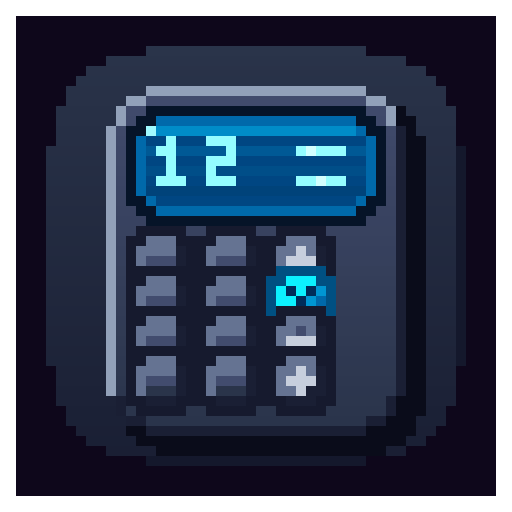

<div align="center">



# orCAL

**A small desktop calculator for Colony, with a phone keypad and a scientific tablet layout.**

</div>

[](LICENSE)
[](https://github.com/Project-Colony/Colony)
[](#installation)

Every desktop ships a calculator, and each one looks, rounds and behaves its
own way. orCAL is one calculator for Linux, Windows and macOS: it opens on a
phone keypad for everyday sums, switches to a scientific keypad in one click,
and sends every expression from either layout to the same Rust engine, so
`0.1+0.2` is 0.3 on every system. It wears the Colony themes, fonts and
accessibility settings, and it contains no network code.

> **Status:** every release from v0.2.2 on is signed and published for the four
> targets below. CI checks formatting and lints, builds, runs `--version` and
> runs the tests on Linux, Windows and macOS, and builds on the Rust 1.90
> floor. The tests cover the engine (operators, precedence, rounding, the
> scientific functions, every error), the preferences file, the folder layout,
> the migration from older versions, the window position and the English and
> French strings. The interface itself, both keypads and the Preferences page,
> has no automated test, and the macOS and Windows builds have not been tried
> by hand: there they are only proven to build, answer `--version` and pass
> the tests.

## Why orCAL

- **The same results everywhere.** One engine in `src/engine.rs` evaluates both
  layouts on all three systems; the interface never evaluates code itself.
- **Two calculators in one window.** The phone layout is for quick sums; the
  tablet layout adds functions, powers, parentheses and the previous answer.
  The window controls in the status bar switch between them.
- **It looks like the rest of Colony.** Every Colony theme, an accent colour,
  the text size, high contrast, the OpenDyslexic font and reduced motion, in
  English or French.
- **Nothing leaves the machine.** No network code, no telemetry, no account,
  and releases that Colony checks against the organisation's signature before
  it installs them.

## What it does

- **Phone layout:** `+`, `-`, `×`, `÷`, `%`, `±`, decimals, backspace and clear.
  No parentheses there.
- **Tablet layout (scientific):** everything above, plus parentheses, sin, cos
  and tan in degrees, ln, log (base 10), square root, `x²`, powers (`xʸ`, right
  associative), `1/x`, factorials (`!`, whole numbers from 0 to 170), the
  constants π and e, and ANS for the previous result.
- **Implicit multiplication:** `2π`, `2(3)` and `(2)(3)` multiply.
- **Rounding that does what you expect:** results are rounded to 12 significant
  digits (whole parts are never cut), and sums and differences to the 15 digits
  an f64 keeps, so `0.1+0.2` gives 0.3, `0.1+0.2-0.3` gives 0 and `1/8` gives
  0.125.
- **Percent:** `%` divides the number before it by 100 at full precision, so
  `200*0.5%` gives 1.
- **Clear errors:** incomplete expression, invalid token, division by zero,
  undefined or infinite result, factorial out of range, and expressions nested
  more than 256 levels deep.
- **Keyboard:** digits, `+ - * /`, `%`, `.` or `,` for the decimal point,
  Enter for `=`, Backspace, and Delete or Escape to clear, in both layouts.
- **Preferences**, opened and closed by clicking the orCAL name at the top left
  of the window, and saved as soon as they change:
  - General: English or French (or the system language), and the layout orCAL
    opens in.
  - Appearance: every Colony theme, an accent colour, the text size and
    animations, with a live preview.
  - Accessibility: high contrast, the OpenDyslexic font, reduced motion (also
    on when the system asks for it) and a reading text size that multiplies
    with the Appearance one.
  - About: the version, the licence and the folders orCAL uses on this machine.
- **French number format:** in French, results and the decimal key use a
  decimal comma.

## Installation

### Via Colony (recommended)

Install [Colony](https://github.com/Project-Colony/Colony), open the
**Utilities** category and install orCAL. Updates arrive through the launcher,
and Colony verifies each release's signature before it installs it.

### Direct binary download

Grab the asset for your platform from the
[latest release](https://github.com/Project-Colony/orCAL/releases/latest). Each
one ships with a matching `.sig`, `.meta` and `.meta.sig`.

| Platform | Asset |
|---|---|
| Linux (x86_64) | `orcal-linux` |
| Windows (x86_64) | `orcal-windows.exe` |
| macOS (Apple Silicon) | `orcal-macos` |
| macOS (Intel) | `orcal-macos-x86` |

There is no installer: download the asset and run it.

```bash
chmod +x orcal-linux && ./orcal-linux
```

`--version` prints the version and exits without opening a window. Releases
up to v0.3.1 predate the flag: they ignore it and open the calculator.

orCAL draws its window with the system web view, so each platform needs it
installed:

- **Linux:** WebKitGTK 4.1, with libsoup 3 and JavaScriptCore 4.1, which it
  pulls in (`libwebkit2gtk-4.1-0` on Debian and Ubuntu, `webkit2gtk-4.1` on
  Arch, `webkit2gtk4.1` on Fedora). The binary is built on GitHub's
  `ubuntu-latest` runner and needs that runner's glibc, 2.39 today: Ubuntu
  24.04, Debian 13, Fedora 40 or newer.
- **Windows:** the Microsoft Edge WebView2 Runtime. Windows 11 includes it; on
  Windows 10, install it from Microsoft if it is missing.
- **macOS:** nothing extra; WebKit is part of the system.

### Build from source

```bash
git clone https://github.com/Project-Colony/orCAL
cd orCAL
cargo build --release
```

Requires Rust 1.90 or newer. On Debian and Ubuntu you also need
`libwebkit2gtk-4.1-dev`; other systems need the equivalent WebKitGTK 4.1
development package on Linux, or the platform toolchain Tauri lists in its
[prerequisites](https://v2.tauri.app/start/prerequisites/). The binary is
`target/release/orCAL` (`orCAL.exe` on Windows). `cargo run` builds and starts
it in one step.

## Documentation

orCAL is small enough to need no `docs/` folder: this page is the user guide,
and the notes below are for anyone reading or changing the code.

`cargo test` runs the engine, preferences, folder layout, migration, window
position and command-line tests, and the checks that keep the English and
French strings complete.

- `src/main.rs`: entry point, `--version` and the Tauri setup
- `src/engine.rs`: parsing and evaluation
- `src/commands.rs`: the commands the interface calls to evaluate an
  expression and to fill the About page
- `src/preferences.rs`: `preferences.json` and the commands that read and
  write it
- `src/paths.rs`: the Colony folder layout
- `src/window_state.rs`: opens the main window on the chosen layout and
  remembers its position between runs
- `src/migrate.rs`: copies the settings of versions before the Colony layout
  and opens the preferences store
- `src/linux_display.rs`: turns off WebKitGTK's DMA-BUF renderer and
  accelerated compositing under Wayland, where they fail on some drivers
- `src/i18n.rs`: tests that hold the two locale files to the same keys
- `src/ui/`: the HTML/CSS/JS interface, `index.html` for the phone layout and
  `tablet-mode/` for the tablet one
- `src/ui/common/`: what both layouts share: the theme tokens and fonts
  (`base.css`), the window chrome, the Preferences page, and the preferences
  and translation layers
- `src/ui/i18n/`: orCAL's own interface strings, `en.json` (canonical) and
  `fr.json`
- `src/ui/fonts/`: JetBrains Mono Nerd Font and OpenDyslexic, each with its
  licence
- `src/ui/vendor/colony/`: the Colony theme data, with the strings every
  Colony program shares (Preferences, theme and accent names), refreshed with
  `scripts/sync-colony-tokens.sh <commit>` and never edited by hand
- `tauri.conf.json`: window, content security policy and capability settings
- `assets/icons/`: application icons

## Code signing policy

Every release asset from v0.2.2 on is signed by the Project Colony organisation
in CI, never on a developer machine; older releases predate signing. Next to
each asset on the release page:

| File | What it is |
|---|---|
| `<asset>.sig` | an ed25519 signature over the asset, made with the organisation's release key |
| `<asset>.meta` | three lines binding the asset to its file name, its sha256 and the release version |
| `<asset>.meta.sig` | an ed25519 signature over the `.meta` |

The private key is an organisation secret, used only by the shared
[sign-and-publish workflow](https://github.com/Project-Colony/Project-Colony-Resources/blob/main/.github/workflows/sign-and-publish.yml)
in a job that builds nothing; the jobs that compile orCAL never see it.
Colony checks all three files before it installs or updates orCAL, and
refuses a release older than the one installed. To check a download yourself
with OpenSSL 3 (the same commands work for every asset):

```bash
cat > colony-release.pub <<'EOF'
-----BEGIN PUBLIC KEY-----
MCowBQYDK2VwAyEARNjg3Nn8H6/aBg1unwGjkUTcrdTxERNefVaqU8cFu0s=
-----END PUBLIC KEY-----
EOF
a=orcal-linux
openssl pkeyutl -verify -pubin -inkey colony-release.pub -rawin -in "$a" -sigfile "$a.sig"
openssl pkeyutl -verify -pubin -inkey colony-release.pub -rawin -in "$a.meta" -sigfile "$a.meta.sig"
cat "$a.meta"     # version=<tag>, asset=<file name>, sha256=<digest>
sha256sum "$a"    # the digest must equal the sha256 line
```

How releases are built, signed and published:
[design/releases.md](https://github.com/Project-Colony/Project-Colony-Resources/blob/main/design/releases.md#5-signing).

<!--
Add the following only once SignPath signs the Windows build, that is once
`signpath-project-slug` is set in .github/workflows/release.yml. Before that it
would promise a signature the .exe does not carry.

Windows releases are also Authenticode-signed. Free code signing provided by
[SignPath.io](https://about.signpath.io/), certificate by
[SignPath Foundation](https://signpath.org/).

- Committers and reviewers: [MotherSphere](https://github.com/MotherSphere)
- Approvers: [MotherSphere](https://github.com/MotherSphere)
-->

## Privacy

This program will not transfer any information to other networked systems
unless specifically requested by the user or the person installing or
operating it.

orCAL contains no network code and sends no telemetry, no analytics and no
crash reports. It has no account and no update check; Colony handles updates.
What it keeps stays on this machine, under `Colony/orCAL/` in the local (never
roaming) application folders:

| Data | Stored or sent | Where, and why |
|---|---|---|
| Preferences | stored | `preferences/preferences.json` in the settings folder: theme, accent, text size, accessibility, language and startup layout, saved as soon as they change. A setting with a bad value falls back to its default; a theme orCAL does not ship becomes Gruvbox dark, Colony's fallback, and an unknown accent becomes the theme's own. A file that orCAL reads but that is not a JSON object is moved to `preferences.json.bak` and orCAL starts from the defaults. A file it cannot read (permissions, a lock) or cannot move aside is left untouched: orCAL starts from the defaults and saves nothing over it until the next launch |
| Window position | stored | `window-position.json` in the settings folder, so the window opens where you left it. On Wayland the compositor decides where windows open |
| Migration marker | stored | `.migrated` in the settings folder, written by the first launch of a version with the Colony layout. It records where the settings of older versions were looked for, so the copy below runs only once |
| Web view profile | stored | the web view's own storage and cache. orCAL keeps nothing of its own there once the old theme below has been imported, so it is cache: `webview/` in the cache folder on Linux and Windows. On macOS, where the web view cannot be given a folder, it uses a non-persistent store kept in memory instead of the system's WebKit folder |
| Expressions and results | neither | kept only in the open window, gone when you close it |

| Folder | Linux | Windows | macOS |
|---|---|---|---|
| Settings | `~/.config/Colony/orCAL/` | `%LOCALAPPDATA%\Colony\orCAL\` | `~/Library/Application Support/Colony/orCAL/` |
| Data (not used) | `~/.local/share/Colony/orCAL/` | `%LOCALAPPDATA%\Colony\orCAL\` | `~/Library/Application Support/Colony/orCAL/` |
| Cache | `~/.cache/Colony/orCAL/` | `%LOCALAPPDATA%\Colony\orCAL\cache\` | `~/Library/Caches/Colony/orCAL/` (not used) |

Preferences > About shows the exact folders on your machine.

Versions before the Colony layout kept these in `com.orcal.app` folders. The
first launch of a newer version copies the window position over and imports
the theme from the old web view storage; the launch after that switches to the
new web view profile. The old `com.orcal.app` folders are left in place and can
be deleted by hand, and so can the `webview/` folder that 0.4.0 kept in the
data folder on Linux and Windows.

The interface is drawn by the operating system's web view (Microsoft Edge
WebView2 on Windows, WebKit on macOS and Linux), which follows its vendor's own
privacy policy.

## License

GPL-3.0-or-later. You may redistribute and modify orCAL under the terms of
version 3 of the GNU General Public License, or (at your option) any later
version. The full text is in [LICENSE](LICENSE).

The bundled fonts, JetBrains Mono Nerd Font and OpenDyslexic, are under the SIL
Open Font License 1.1, whose text sits next to each of them in `src/ui/fonts/`.
